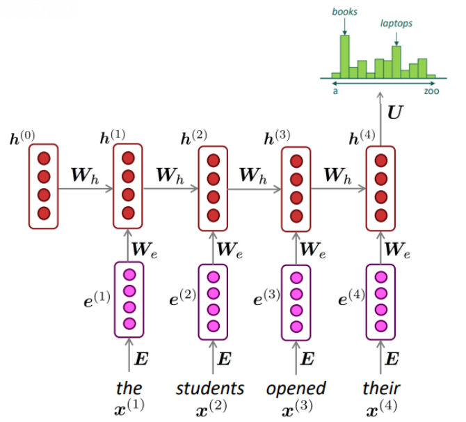
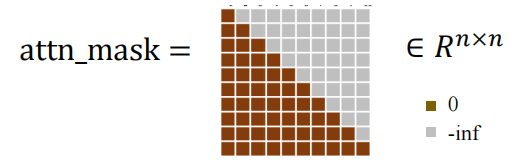

# Autoregressive (AR) Models

An **autoregressive (AR) model** represents a joint distribution as a product of conditional distributions, predicting each element given the preceding elements:

$$
p_\theta(x_1,\ldots,x_n)
=
\prod_{i=1}^{n}
p_\theta(x_i\mid x_1,\ldots,x_{i-1}),
$$

where the first factor is $p_\theta(x_1)$. It generates samples one element at a time.

**Training objective:** Minimize the average negative log-likelihood over the training data. For one sequence:

$$
\mathcal{L}(\theta;x)
=
-\log p_\theta(x_1,\ldots,x_n)
=
-\sum_{i=1}^{n}\log p_\theta(x_i\mid x_{<i}),
$$

where $x_{<i}=(x_1,\ldots,x_{i-1})$. During training, each prediction is conditioned on the observed prefix (*teacher forcing*).

**Evaluation:** Perplexity is the exponential of the average token-level negative log-likelihood on held-out data.

$$
\operatorname{PPL}(x)
=
\exp\left(\frac{\mathcal{L}(\theta;x)}{n}\right).
$$

Lower perplexity is better when evaluated on the same data with the same tokenization.

**Generation:** Sample one element at a time, conditioned on the previously generated elements:

$$
\hat{x}_i\sim p_\theta(\,\cdot\mid \hat{x}_{<i}).
$$

Start from an empty sequence or a given prompt, and append each sampled element. Stop when an end-of-sequence token is generated or the specified length is reached.

Alternatively, greedy decoding selects the most probable next token at each step:

$$
\hat{x}_i
=
\arg\max_v p_\theta(v\mid\hat{x}_{<i}).
$$

Autoregressive models can be implemented in various ways, including n-gram models and fixed-window models. Among these approaches, RNNs and Transformers are two effective and well-known choices.

## RNN-Based Autoregressive Models

An RNN updates its hidden state using the previous state and the current token, then uses the updated state to predict the next token:

$$
h_t = f_W(h_{t-1}, x_t)
$$

Here, $h_t$ is used to predict $x_{t+1}$.

The architecture is as follows.

Unlike fixed-window models, RNNs can carry information beyond a fixed context window through their hidden states, although their ability to retain long-range information is limited.

## Transformer-Based Autoregressive Models

A decoder-only Transformer combines causal self-attention, feed-forward layers, and positional information to model next-token distributions.

For input representations $X$, define $Q=XW_Q$, $K=XW_K$, and $V=XW_V$. Each attention head computes:

$$
\operatorname{Attention}(Q,K,V)
=
\operatorname{softmax}\left(
\frac{QK^\top}{\sqrt{d_k}}+M
\right)V,
$$

where $d_k$ is the key dimension.

To predict the next token $x_{i+1}$ using only $x_1,\ldots,x_i$, we add a causal mask to the attention scores before softmax. This blocks attention to future tokens and prevents information leakage during training.

$$
M_{ij}=
\begin{cases}
0, & j\le i,\\
-\infty, & j>i.
\end{cases}
$$

The final representation $h_t$ is used to predict $x_{t+1}$:

$$
p_\theta(\,\cdot\mid x_{\le t})
=
\operatorname{softmax}(W_o h_t+b_o).
$$

## Computational Complexity Comparison

Let $n$ be the sequence length. Assume fixed model size, full causal attention, and generation from an empty prefix.

| Model | Training: total cost | Generation: cost at step $t$ | Generation: total cost |
|---|---|---|---|
| RNN | $O(n)$ | $O(1)$ | $O(n)$ |
| Transformer | $O(n^2)$ | $O(t)$ | $O(n^2)$ |

Generation reuses the RNN hidden state or a Transformer KV cache.

**Training:** RNNs process positions sequentially. Transformers can process positions in parallel during teacher-forced training, enabling efficient GPU computation despite their higher total operation count.

**Generation:** Both models generate tokens sequentially. Their total costs are:

$$
T_{\mathrm{RNN}}=\sum_{t=1}^{n}O(1)=O(n),
\qquad
T_{\mathrm{Transformer}}=\sum_{t=1}^{n}O(t)=O(n^2).
$$

Without KV caching, recomputing a full Transformer forward pass over every prefix instead costs $\sum_{t=1}^{n}O(t^2)=O(n^3)$. 