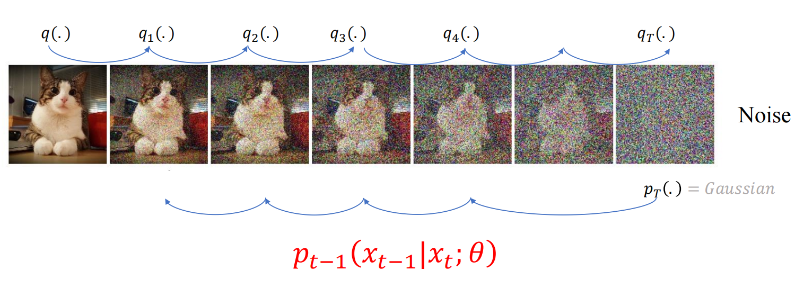
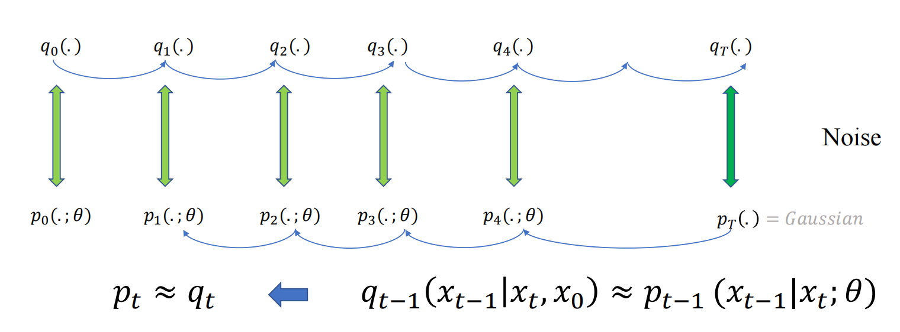

# Diffusion Models

## What is diffusion?

Inspired by physical diffusion, DDPM uses a fixed forward process that gradually adds Gaussian noise while attenuating the original signal. This transforms a complex data distribution into a distribution close to the standard Gaussian $\mathcal{N}(0,I)$.

A neural network learns to reverse this process step by step, allowing us to generate new data samples starting from Gaussian noise.

- Diffusion models share a similar high-level idea with VAEs: both generate data from a simple latent distribution.

This leads to three challenges:

1. How do we define and simulate the forward diffusion process?
2. How do we model the reverse denoising process?
3. How do we train the model?

## Forward process

The forward process adds Gaussian noise while attenuating the original signal, finally transforming the complex data distribution into a distribution close to the standard Gaussian $\mathcal{N}(0,I)$.

Starting from $x_0\sim q_0$, we obtain $x_t\sim q_t$, where $q_t$ is the forward marginal at step $t$.

At each step:

$$
\begin{aligned}
q(x_t\mid x_{t-1})
&=\mathcal N\!\left(x_t;\sqrt{1-\beta_t}\,x_{t-1},\beta_t I\right),\\
x_t
&=\sqrt{1-\beta_t}\,x_{t-1}+\sqrt{\beta_t}\,\epsilon_t,
\qquad \epsilon_t\sim\mathcal N(0,I).
\end{aligned}
$$

- Here, $\beta_t\in(0,1)$ is the fixed noise variance, and $\epsilon_t$ is fresh independent noise.

Direct sampling from $x_0$:

$$
\begin{aligned}
q(x_t\mid x_0)
&=\mathcal N\!\left(x_t;\sqrt{\alpha_t}\,x_0,(1-\alpha_t)I\right),\\
x_t
&=\sqrt{\alpha_t}\,x_0+\sqrt{1-\alpha_t}\,\epsilon,
\qquad \epsilon\sim\mathcal N(0,I).
\end{aligned}
$$

- Here, $\alpha_t=\prod_{s=1}^{t}(1-\beta_s)$. For $\alpha_T\approx0$, $q_T\approx\mathcal N(0,I)$.

## Backward process

Starting from Gaussian noise,

$$
x_T\sim p_T,\qquad p_T=\mathcal N(0,I),\qquad q_T\approx p_T.
$$

the reverse process generates data through successive denoising steps:

$$
\begin{aligned}
p_\theta(x_{t-1}\mid x_t)
&=\mathcal N\!\left(x_{t-1};\mu_\theta(x_t,t),\sigma_t^2I\right),\\
x_{t-1}
&=\mu_\theta(x_t,t)+\sigma_t z_t,
\qquad z_t\sim\mathcal N(0,I).
\end{aligned}
$$

Here, $x_t\sim p_t$ under the reverse process. The notation $p_\theta(x_0)$ in training denotes the marginal density $p_0(x_0)$.

A shared network predicts $\mu_\theta(x_t,t)$, while $\sigma_t^2$ is preset. We aim for $p_t\approx q_t$, especially $p_0\approx q_0$.

The marginals $q_t$ and $p_t$ need not be Gaussian; the Gaussian assumptions above apply to the conditional distributions and the terminal prior.

## DDPM training

### Diffusion ELBO

Maximize the expected log-likelihood:

$$
\max_\theta\;
\mathbb E_{q_0(x_0)}[\log p_\theta(x_0)]
\quad\Longleftrightarrow\quad
\min_\theta\;
\mathbb E_{q_0(x_0)}[-\log p_\theta(x_0)].
$$

Let $z=(x_1,\ldots,x_T)$. Exact likelihood requires marginalization:

$$
p_\theta(x_0)=\int p_\theta(x_0,z)\,dz.
$$

Use the fixed forward distribution:

$$
q(z\mid x_0)=\prod_{t=1}^{T}q(x_t\mid x_{t-1}),
\qquad
q(x_0,z)=q_0(x_0)q(z\mid x_0).
$$

Write $\mathbb E_q$ for expectation under $q(x_0,z)$. The loss is independent of $z$:

$$
\mathbb E_{q_0(x_0)}[-\log p_\theta(x_0)]
=
\mathbb E_q[-\log p_\theta(x_0)].
$$

Insert $q(z\mid x_0)/q(z\mid x_0)$ and use

$$
p_\theta(x_0)
=
\frac{p_\theta(x_0,z)}{p_\theta(z\mid x_0)}.
$$

Then

$$
\begin{aligned}
\mathbb E_{q_0}[-\log p_\theta(x_0)]
&=
\mathbb E_q\left[
-\log\left(
\frac{q(z\mid x_0)}{q(z\mid x_0)}
p_\theta(x_0)
\right)
\right]\\[4pt]
&=
\mathbb E_q\left[
-\log\left(
\frac{q(z\mid x_0)}{q(z\mid x_0)}
\frac{p_\theta(x_0,z)}{p_\theta(z\mid x_0)}
\right)
\right]\\[4pt]
&=
\mathbb E_q\left[
-\log\frac{q(z\mid x_0)}{p_\theta(z\mid x_0)}
\right]
+
\mathbb E_q\left[
-\log\frac{p_\theta(x_0,z)}{q(z\mid x_0)}
\right].
\end{aligned}
$$

By KL nonnegativity:

$$
\mathbb E_q\left[
-\log\frac{q(z\mid x_0)}{p_\theta(z\mid x_0)}
\right]
=
-\mathbb E_{q_0}\left[
D_{\mathrm{KL}}\!\left(
q(z\mid x_0)\,\|\,p_\theta(z\mid x_0)
\right)
\right]
\le0.
$$

Thus,

$$
\begin{aligned}
\mathbb E_{q_0}[-\log p_\theta(x_0)]
&\le
\mathbb E_q\left[
-\log\frac{p_\theta(x_0,z)}{q(z\mid x_0)}
\right],\\[4pt]
\mathbb E_{q_0}[\log p_\theta(x_0)]
&\ge
\mathbb E_q\left[
\log\frac{p_\theta(x_0,z)}{q(z\mid x_0)}
\right].
\end{aligned}
$$

This lower bound is the **ELBO**. We minimize its negative:

$$
\begin{aligned}
\operatorname{ELBO}(\theta)
&:=\mathbb E_q\left[
\log\frac{p_\theta(x_0,z)}{q(z\mid x_0)}
\right],\\[4pt]
\mathcal L_{\mathrm{VLB}}(\theta)
&:=-\operatorname{ELBO}(\theta)
=\mathbb E_q\left[
-\log\frac{p_\theta(x_0,z)}{q(z\mid x_0)}
\right].
\end{aligned}
$$

Factorize the paths:

$$
p_\theta(x_0,z)
=
p_T(x_T)\prod_{t=1}^{T}p_\theta(x_{t-1}\mid x_t),
$$

$$
q(z\mid x_0)
=
q(x_T\mid x_0)
\prod_{t=2}^{T}q(x_{t-1}\mid x_t,x_0).
$$

Substitute:

$$
\begin{aligned}
\mathcal L_{\mathrm{VLB}}
=
\mathbb E_q\Bigg[
&-\log p_\theta(x_0\mid x_1)
+\log\frac{q(x_T\mid x_0)}{p_T(x_T)}\\
&+\sum_{t=2}^{T}
\log\frac{
q(x_{t-1}\mid x_t,x_0)
}{
p_\theta(x_{t-1}\mid x_t)
}
\Bigg].
\end{aligned}
$$

Taking conditional expectations gives:

$$
\begin{aligned}
\mathcal L_{\mathrm{VLB}}
={}&
\underbrace{
\mathbb E_q[-\log p_\theta(x_0\mid x_1)]
}_{\text{reconstruction}}\\
&+
\underbrace{
\sum_{t=2}^{T}
\mathbb E_q\left[
D_{\mathrm{KL}}\!\left(
q(x_{t-1}\mid x_t,x_0)
\,\|\,
p_\theta(x_{t-1}\mid x_t)
\right)
\right]
}_{\text{denoising}}\\
&+
\underbrace{
\mathbb E_{q_0}\left[
D_{\mathrm{KL}}\!\left(
q(x_T\mid x_0)\,\|\,p_T(x_T)
\right)
\right]
}_{\text{prior matching}}.
\end{aligned}
$$

Drop the prior term, which is constant in $\theta$:

$$
\boxed{
\min_\theta\;
\mathbb E_q\left[
-\log p_\theta(x_0\mid x_1)
+
\sum_{t=2}^{T}
D_{\mathrm{KL}}\!\left(
q(x_{t-1}\mid x_t,x_0)
\,\|\,
p_\theta(x_{t-1}\mid x_t)
\right)
\right].
}
$$

- Intuition: By minimizing the expected KL divergence between $q(x_{t-1}\mid x_t,x_0)$ and $p_\theta(x_{t-1}\mid x_t)$, we encourage $p_t\approx q_t$.

### Reparameterization

For $t\ge2$, the forward posterior is Gaussian:

$$
q(x_{t-1}\mid x_t,x_0)
=\mathcal N\!\left(x_{t-1};\tilde\mu_t(x_t,x_0),\tilde\beta_t I\right),
$$

$$
\tilde\mu_t(x_t,x_0)
=\frac{\sqrt{\alpha_{t-1}}\beta_t}{1-\alpha_t}x_0
+\frac{\sqrt{1-\beta_t}(1-\alpha_{t-1})}{1-\alpha_t}x_t,
\qquad
\tilde\beta_t=\frac{1-\alpha_{t-1}}{1-\alpha_t}\beta_t.
$$

With fixed variances, the KL loss becomes a weighted mean error:

$$
D_{\mathrm{KL}}\!\left(
q(x_{t-1}\mid x_t,x_0)\,\|\,p_\theta(x_{t-1}\mid x_t)
\right)
=\frac{1}{2\sigma_t^2}
\left\|\tilde\mu_t(x_t,x_0)-\mu_\theta(x_t,t)\right\|_2^2+C_t,
$$

where $C_t$ is independent of $\theta$.

Express $x_0$ in terms of the added noise:

$$
\begin{aligned}
x_t&=\sqrt{\alpha_t}\,x_0+\sqrt{1-\alpha_t}\,\epsilon,
\qquad \epsilon\sim\mathcal N(0,I),\\
x_0&=\frac{x_t-\sqrt{1-\alpha_t}\,\epsilon}{\sqrt{\alpha_t}}.
\end{aligned}
$$

Substitute into the target mean, using $\alpha_t=(1-\beta_t)\alpha_{t-1}$:

$$
\begin{aligned}
\tilde\mu_t(x_t,x_0)
&=\frac{\sqrt{\alpha_{t-1}}\beta_t}{1-\alpha_t}
\frac{x_t-\sqrt{1-\alpha_t}\,\epsilon}{\sqrt{\alpha_t}}
+\frac{\sqrt{1-\beta_t}(1-\alpha_{t-1})}{1-\alpha_t}x_t\\[4pt]
&=\frac{1}{\sqrt{1-\beta_t}}
\left(x_t-\frac{\beta_t}{\sqrt{1-\alpha_t}}\epsilon\right).
\end{aligned}
$$

Let the network predict $\epsilon_\theta(x_t,t)$ and define the reverse mean as

$$
\mu_\theta(x_t,t)
=\frac{1}{\sqrt{1-\beta_t}}
\left(x_t-\frac{\beta_t}{\sqrt{1-\alpha_t}}\epsilon_\theta(x_t,t)\right).
$$

The mean error becomes a noise prediction error:

$$
\frac{1}{2\sigma_t^2}
\left\|\tilde\mu_t(x_t,x_0)-\mu_\theta(x_t,t)\right\|_2^2
=
\frac{\beta_t^2}{2\sigma_t^2(1-\beta_t)(1-\alpha_t)}
\left\|\epsilon-\epsilon_\theta(x_t,t)\right\|_2^2.
$$

Removing the time-dependent weights and applying noise prediction at all steps gives

$$
\boxed{
\mathcal L_{\mathrm{simple}}(\theta)
=
\mathbb E_{x_0,t,\epsilon}\left[
\left\|
\epsilon-\epsilon_\theta\!\left(
\sqrt{\alpha_t}\,x_0+\sqrt{1-\alpha_t}\,\epsilon,t
\right)
\right\|_2^2
\right],
}
$$

where $x_0\sim q_0$, $t\sim\mathrm{Uniform}\{1,\ldots,T\}$, and $\epsilon\sim\mathcal N(0,I)$ are sampled independently. This reweighting changes the training objective.

- Intuition: Predict the added noise, then use it to compute the denoising mean.
